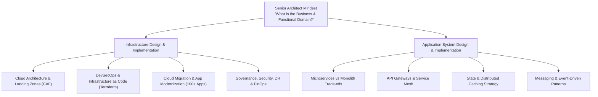
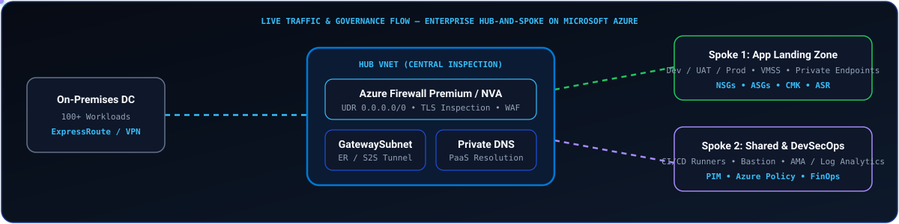
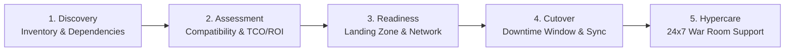
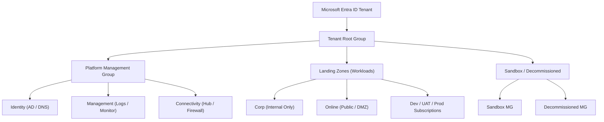
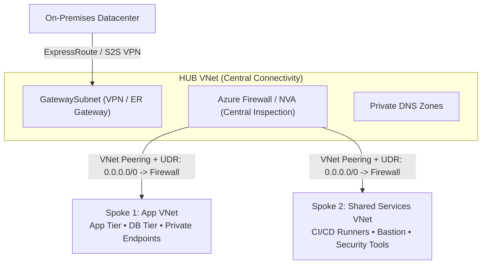
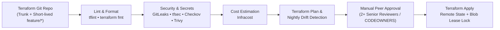
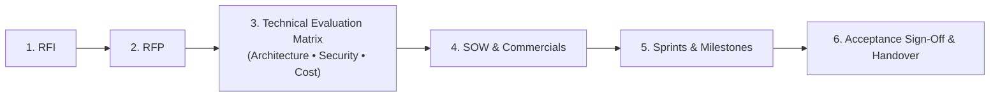
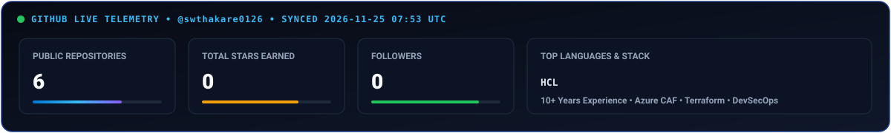

  

  

---

## 🧠 The Senior Mindset: Business & Architecture Alignment

> *"Before choosing a service or writing a single line of Terraform, answer two questions: **What is the business? What is the functional domain?**"*

With **10+ years of experience** spanning enterprise infrastructure, cloud transformations, and DevSecOps engineering, I bridge business outcomes with resilient technical architecture—leading multi-environment transformations from strategy and RFP/SOW governance through production cutover and 24x7 hypercare.

### 🎯 Executive & Technical Leadership

| Leadership Pillar | Key Responsibilities & Impact |
| :--- | :--- |
| **Leadership & Team Upskilling** | Running structured KT sessions, mentoring engineers into senior/lead roles, and leading senior technical interview panels. |
| **Vendor & Service Management** | Driving RFI/RFP evaluations, SOW negotiations, technical scoring matrices, deliverable sign-offs, and SLA/RACI/escalation governance. |
| **Pre-Sales & Architecture Proposals** | Authoring technical estimations, TCO/ROI assessments, architecture POCs, and RFP/RFI solution responses. |
| **Delivery & Operational Governance** | Establishing engineering SOPs, blameless incident retrospectives, drift prevention, and architecture compliance reviews. |

---

## 🛠️ Core Technology & Governance Stack

| Domain | Capabilities & Tools |
| :--- | :--- |
| **Cloud & Identity** | Microsoft Azure, Cloud Adoption Framework (CAF), Microsoft Entra ID, Conditional Access, MFA, PIM (JIT), RBAC, Azure Policy (CIS / MCSB) |
| **IaC & Automation** | Terraform (Modular, Semantic Versioning, Blob Lease State Locking, Drift Detection), Cloud-Init, Python, PowerShell, Bash |
| **DevSecOps & CI/CD** | GitHub Actions, Azure Repos & YAML Pipelines, `tflint`, `tfsec`, Checkov, Trivy, GitLeaks, Infracost, `CODEOWNERS` & PR Gates |
| **Networking & Security** | Hub-and-Spoke Topology, ExpressRoute / S2S VPN, IPAM, Azure Firewall Premium / NVA, UDRs, App Gateway / Front Door WAF, Private Endpoints, Private DNS, NSGs/ASGs, Defender for Cloud, CMK |
| **Migration, HA & DR** | Azure Migrate (100+ Workload Migrations), VMSS across Availability Zones, LRS/ZRS/GRS, Azure Site Recovery (ASR), RTO/RPO Design |
| **Observability & FinOps** | Azure Monitor, Azure Monitor Agent (AMA), Log Analytics, Data Collection Rules (DCR), Action Groups (Teams/Slack/PagerDuty), Reserved Instances, Savings Plans, Rightsizing |

---

## 🏛️ Enterprise Architecture Blueprints

  

 

<strong>1. Real-World Scenario: 100+ Application Enterprise Migration & 10 Quality Pillars</strong>

 

**Problem Statement:** Migrating **100+ enterprise workloads** across `Dev`, `UAT`, and `Production` from an On-Premises Datacenter to Microsoft Azure with zero unapproved downtime and strict compliance.

#### The 10 Scalability & Quality Pillars

| # | Pillar | # | Pillar |
| :-: | :--- | :-: | :--- |
| **1** | **Scalable** — Horizontal/vertical elasticity (VMSS, PaaS) | **6** | **Governed** — Management Groups, Azure Policy, RBAC |
| **2** | **Robust** — Fault-isolated tiers & automated healing | **7** | **High Availability** — Multi-AZ compute & ZRS storage |
| **3** | **Secure** — Zero Trust, Private Endpoints, WAF, PIM | **8** | **Cost-Optimized** — FinOps rightsizing, RI, DCR tuning |
| **4** | **Reliable** — Deterministic IaC & validated cutovers | **9** | **Backed Up** — GRS replication & tested ASR runbooks |
| **5** | **Portable** — Parameterized modules & cloud-init automation | **10** | **Compliant & Monitored** — CIS/MCSB, AMA, 24x7 alerting |

#### End-to-End Migration Lifecycle

- **Pre-Migration:** Azure Migrate discovery reports, dependency mapping, ExpressRoute/VPN bandwidth sizing, target Landing Zone validation, and backup verification.
- **During Cutover:** DNS TTL reduction, database replication sync, traffic rerouting, and automated smoke/validation tests.
- **Post-Migration & Hypercare:** Health telemetry verification, end-user sanity testing, performance benchmarking, and 2–4 weeks of dedicated war room support.

<strong>2. Enterprise Governance, CAF Methodology & Management Group Hierarchy</strong>

 

#### Microsoft Cloud Adoption Framework (CAF) Six Phases
1. **Strategy:** Business justification, executive alignment, and measurable ROI.
2. **Plan:** Workload rationalization, org structure, and skill readiness.
3. **Ready:** Landing zone preparation, networking, and identity foundation.
4. **Adopt:** Migration waves and application modernization sprints.
5. **Govern:** Azure Policy guardrails, cost controls, and compliance benchmarks.
6. **Secure & Manage:** Continuous monitoring, automated patching, and threat protection.

#### Tenant & Management Group Hierarchy

- **Subscription Boundaries:** Separate subscriptions by environment (`Dev`, `UAT`, `Prod`) and function (`Platform` vs `Application`) to isolate blast radiuses and prevent noisy neighbors.
- **Azure Policy & Initiatives:** Assign built-in initiatives (`CIS Azure Benchmark`, `MCSB`) at Management Group scope with `Audit`/`Deny` effects and documented, time-bound exemptions.
- **RBAC & PIM:** Group-based RBAC via Entra ID with Privileged Identity Management (PIM) enforcing just-in-time (JIT) elevation and multi-stage approvals.

<strong>3. Enterprise Hub-and-Spoke Networking Architecture</strong>

 

- **IPAM & Non-Overlapping CIDR:** Comprehensive audit of on-premises CIDRs before VNet allocation to eliminate routing conflicts.
- **Centralized Traffic Inspection:** UDRs force `0.0.0.0/0` and inter-spoke traffic through Azure Firewall / NVA.
- **Controlled Ingress & Egress:** Outbound Internet egress via Firewall with TLS inspection; inbound traffic fronted by Application Gateway / Azure Front Door with WAF.
- **Private PaaS Connectivity:** Private Endpoints for Key Vault, Storage, and SQL resolved through centralized Hub-linked Private DNS Zones.

<strong>4. Multi-Layered Defense-in-Depth Security</strong>

 

| Security Layer | Key Controls & Technologies |
| :--- | :--- |
| **Identity Level** | Microsoft Entra ID, Conditional Access, MFA, Privileged Identity Management (PIM), Service Principals & Managed Identities |
| **Networking Level** | Hub-and-Spoke isolation, Micro-segmentation (NSGs / ASGs), Azure Firewall Premium, Private Endpoints, DDoS Protection Standard |
| **Governance Level** | Azure Policy enforcement, CIS / ISO 27001 compliance benchmarks, Microsoft Defender for Cloud Secure Score |
| **Compute Level** | Defender for Servers, automated vulnerability scanning, Disk Encryption with Customer Managed Keys (CMK), automated OS patch baselines |

<strong>5. Terraform Landing Zone Automation & DevSecOps CI/CD Flow</strong>

 

- **Remote State Security:** Private Azure Storage Account with blob lease locking, encryption at rest, and Least Privilege Managed Identity access.
- **Modular IaC:** Reusable, parameterized Terraform modules with strict semantic versioning (`vX.Y.Z`).
- **Automated Drift Detection:** Nightly scheduled `terraform plan -detailed-exitcode` pipelines to catch out-of-band portal changes immediately.
- **Branch & Pipeline Governance:** Strict protection on `main` (no direct push, no delete), `CODEOWNERS` enforcement, VM custom data / Cloud-Init bootstrapping, and automated failure rollback plans.

<strong>6. FinOps, Backup/DR & Enterprise Observability</strong>

 

| Pillar | Operational Practices & Architecture Standards |
| :--- | :--- |
| **FinOps (Cloud Financial Management)** | Remove orphaned disks, snapshots, and unassociated public IPs; rightsize VMs on 30-day CPU/Memory percentiles; apply 1-yr/3-yr Reserved Instances & Savings Plans; automate non-prod start/stop schedules; tune Log Analytics ingestion via Data Collection Rules (DCR). |
| **Backup, HA & Disaster Recovery** | Storage redundancy matched to tier (`LRS` / `ZRS` / `GRS`); Multi-AZ compute via VMSS; explicit **RTO** (max downtime) & **RPO** (max data loss, e.g., ≤15 min) targets; Azure Site Recovery (ASR) replication to secondary paired region. |
| **Enterprise Observability** | Centralized Log Analytics Workspace per Landing Zone; Azure Monitor Agent (AMA) with source filtering via DCRs; Action Groups routing critical alerts to Microsoft Teams, Slack, and PagerDuty. |

<strong>7. Vendor Management & Delivery Governance Lifecycle</strong>

 

- **SOW Governance:** Clear scope, deliverables, acceptance criteria, milestones, and liability clauses.
- **RACI & Escalation Matrices:** Single **Accountable** owner per deliverable, explicit **Responsible / Consulted / Informed** roles, and SLA-backed escalation paths.
- **Transition & KT:** Architecture walk-throughs, operational runbooks, and shadowing prior to formal sign-off.

---

## ⚡ Automated GitHub Snapshot

> This profile includes automated DevSecOps workflows in [`.github/workflows`](.github/workflows):
> - **Daily Profile Sync** ([`update-profile.yml`](.github/workflows/update-profile.yml)) — Automatically refreshes stats, repositories, and recent activity using the GitHub API.
> - **Profile CI Gate** ([`profile-ci.yml`](.github/workflows/profile-ci.yml)) — Runs unit tests, marker integrity checks, and secret-hygiene validation on every push and PR.
> - **Contribution Snake** ([`snake.yml`](.github/workflows/snake.yml)) — Generates dark/light contribution grid animations onto the `output` branch.

<!-- START_SECTION:snake -->
<picture>
  <source media="(prefers-color-scheme: dark)" srcset="https://raw.githubusercontent.com/swthakare0126/swthakare0126/output/github-contribution-grid-snake-dark.svg" />
  <source media="(prefers-color-scheme: light)" srcset="https://raw.githubusercontent.com/swthakare0126/swthakare0126/output/github-contribution-grid-snake.svg" />
  
</picture>
<!-- END_SECTION:snake -->

### 📊 Profile Metrics

  

 

<!-- START_SECTION:stats -->
| Metric | Value |
| :--- | :--- |
| Public Repositories | **6** |
| Total Stars Earned | **0** |
| Followers | **0** |
| Top Languages | HCL |
| Last Auto-Synced (UTC) | `2026-11-25 07:53 UTC` |
<!-- END_SECTION:stats -->

### 📦 Featured & Recently Updated Repositories
<!-- START_SECTION:repos -->
| Repository | Description | Language | Stars | Updated |
| :--- | :--- | :--- | :-: | :--- |
| [network-infrastructure-terraform](https://github.com/swthakare0126/network-infrastructure-terraform) | Azure infrastructure using Terraform — Resource Groups, Storage Accounts, VNets, Subnet... | `HCL` | ⭐ 0 | `2026-09-07` |
| [CSV-Format-RG](https://github.com/swthakare0126/CSV-Format-RG) | No description provided. | `HCL` | ⭐ 0 | `2026-08-31` |
| [azure-landing-zone-terraform](https://github.com/swthakare0126/azure-landing-zone-terraform) | Terraform-based Azure infrastructure project implementing networking, virtual machines,... | `HCL` | ⭐ 0 | `2026-08-31` |
| [DevOps-DevSecOps](https://github.com/swthakare0126/DevOps-DevSecOps) | End-to-end DevOps and DevSecOps repository featuring Azure Cloud, Terraform, GitHub Act... | `HCL` | ⭐ 0 | `2026-06-11` |
<!-- END_SECTION:repos -->

### 🔄 Recent GitHub Activity
<!-- START_SECTION:activity -->
_No recent public GitHub activity found._
<!-- END_SECTION:activity -->

---

### 🤝 Open to Architecture Advisory, Cloud Transformations & Senior Engineering Leadership

⚡ Automated & validated via GitHub Actions • Built with DevSecOps principles

  

